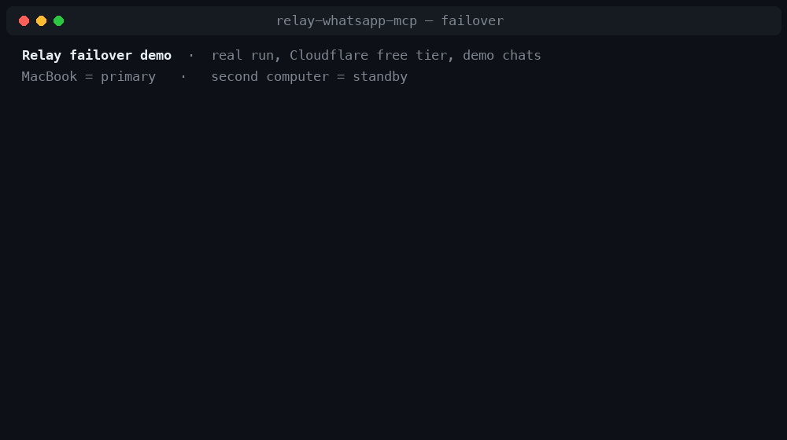

# Relay

**Your WhatsApp, as 37 MCP tools for Claude and ChatGPT: self-hosted, failover-ready, and free to run.**

[](https://github.com/viaanshetty3-debug/relay-whatsapp-mcp/actions/workflows/ci.yml)
[](LICENSE)
[](https://nodejs.org)
[](#auto-start-on-login)
[](#tool-reference)
[](SECURITY.md)
[](https://www.npmjs.com/package/relay-whatsapp-mcp)

**[💬 Ask Relay AI (Free Live Assistant)](https://relay-docs-ai.viaan-mcp.workers.dev)**: a help page with a searchable troubleshooting guide and an AI chat sidebar for questions about setup, failover, the 37 tools or security. It's free, with no login or key, and each visitor's chat stays private in their own browser. Answers come from these docs via Cloudflare Workers AI and can be wrong. If the free daily AI allowance runs out, it answers from a docs search instead.

## Quickstart with npx

Needs [Node.js 22.13+](https://nodejs.org). Nothing to clone:

```bash
npx relay-whatsapp-mcp setup    # creates keys, prints your Claude configs
npx relay-whatsapp-mcp start    # open http://127.0.0.1:8787, create your account, scan the QR code
```

Leave `start` running. Then connect Claude Code on the same computer:

```bash
claude mcp add whatsapp -- npx -y relay-whatsapp-mcp mcp
```

For Claude Desktop, add this to `claude_desktop_config.json` and restart it:

```json
{ "mcpServers": { "whatsapp": { "command": "npx", "args": ["-y", "relay-whatsapp-mcp", "mcp"] } } }
```

Try it without a WhatsApp account first: `npx relay-whatsapp-mcp demo` (sample chats). `npx relay-whatsapp-mcp doctor` checks everything; `help` lists all commands. Your private files (`.env`, the WhatsApp session, data) live in `~/.relay-whatsapp-mcp`, never inside npm's folders; set `RELAY_HOME` to change that. If Claude Desktop reports that `npx` was not found, put the full path from `which npx` (`where npx` on Windows) in `"command"`. To run Relay at login, install it permanently with `npm install -g relay-whatsapp-mcp`, then run `relay-whatsapp-mcp autostart`. The optional Cloudflare relay (Claude on your phone, failover) is deployed from a clone: see the [5-minute quickstart](#5-minute-quickstart).

<p align="center"></p>
<p align="center"><sub>A real run on Cloudflare's free plan with two demo bridges (fake chats), replayed from the recorded terminal output; the waiting part is sped up 2×. The client calls Relay through the same doorway Claude uses.</sub></p>

Relay links your own WhatsApp account as a **linked device** (like WhatsApp Web) on a computer you control and exposes it to AI assistants through the [Model Context Protocol](https://modelcontextprotocol.io). Ask Claude to summarise a group chat, find the address a friend sent last month, transcribe a voice note, or draft and send a reply. It acts only when you ask it to.

```
   ┌──────────┐                 ┌──────────┐
   │ ChatGPT  │                 │  Claude  │   claude.ai · Desktop · Code · mobile
   └────┬─────┘                 └────┬─────┘
        │ owner sign-in               │ x-api-key
        │                    ┌────────▼──────────┐
        │                    │ Cloudflare doorway│  claude-proxy/ (free Worker)
        │                    └────────┬──────────┘
        │                             │ client key
   ┌────▼─────────────────────────────▼──────────┐
   │            Relay  (relay-worker/)            │  owner-only MCP endpoint
   │  queue encrypted at rest · AES-256-GCM       │  Worker + D1 (free tier)
   └───────────────┬────────────────┬─────────────┘
       outbound    │ long poll      │ long poll    outbound only:
       HTTPS only  │                │              no open ports at home
   ┌───────────────▼─────┐   ┌──────▼──────────────────┐
   │  Primary bridge     │   │  Standby bridge         │
   │  macOS·Linux·Windows│   │  macOS·Linux·Windows    │
   │  WhatsApp linked    │   │  (optional) its own     │
   │  device #1          │   │  linked device #2       │
   └─────────────────────┘   └─────────────────────────┘
         WhatsApp keys and message history never leave these machines
```

You don't need the hosted part: a single bridge with Claude Desktop or Claude Code on the same computer works with no hosting at all.

---

## Why Relay

### 37 WhatsApp tools, not just "send a message"
Read and search history, follow live events with a durable cursor, download and **analyse attachments up to 500 MB** (local transcription, PDF/OCR, video frames, optional local vision), send and reply, edit, delete, react, forward, polls, drafts, scheduled messages, groups and presence. [Full reference ↓](#tool-reference)

### Failover in about 4–6 seconds, never sending twice
- Run an optional **standby** bridge on a second computer. If the primary sleeps or loses its connection, the standby starts serving after about **4–6 seconds** of silence (about 7–9 s with the free-tier setting), then steps back when the primary returns.
- **Reads in progress are handed over.** If a device goes silent in the middle of a read-only request, the relay re-queues that request for the other device.
- **Writes are never re-queued or retried automatically** (send, edit, delete, react, groups and so on). Each queued request is claimed by exactly one device (an atomic `UPDATE … WHERE status='queued'`). A write that times out is reported as *may have executed*, with an instruction to check the chat instead of retrying. `send_message` also accepts a `requestId`, so a retry with the same ID is de-duplicated, and an interrupted scheduled send is marked *uncertain* rather than re-sent.

### Built-in defences against indirect prompt injection
Incoming WhatsApp content is written by other people, so Relay treats it as **data, never instructions**:
- Every MCP server Relay exposes (local, remote and relay) carries server instructions saying that message text, attachments and contact names are untrusted and must not be followed as instructions.
- Attachment and analysis results are labelled as untrusted content.
- Writes happen only through explicit, schema-validated tool calls. `READ_ONLY=true` turns off every outgoing action, and `ALLOWED_CHATS` limits which chats the AI can see at all.
- Reading never sends read receipts, so an AI browsing your chats doesn't reveal that you've seen them.

These measures reduce the risk; they can't make a language model immune to manipulation. See [SECURITY.md](SECURITY.md).

### Cross-platform, runs on free tiers
- The bridge is plain Node.js, so it runs on **macOS, Linux and Windows**. It also runs on Android (Termux) as an experimental option.
- **Auto-start** templates for launchd, systemd and Task Scheduler, installed with one command.
- No AI API key, no subscription and no per-message fees. The relay and the Claude doorway both run on Cloudflare's **free** Workers and D1 plans. See [free-tier budget](#free-tier-budget) for the numbers.

---

## 5-minute quickstart

**You need:** Node.js 22.13+ and WhatsApp on your phone.

```sh
git clone https://github.com/viaanshetty3-debug/relay-whatsapp-mcp.git && cd relay-whatsapp-mcp
npm install
npm run setup
```

`npm run setup` (macOS, Linux and Windows):
1. generates strong random keys (32 bytes each, from `crypto.randomBytes`),
2. asks for your relay and Cloudflare doorway URLs. **Both are optional**: press Enter to stay local-only,
3. writes a private `.env` (and, if you use them, `relay-worker/.secrets.json` and `claude-proxy/.secrets.json` for deploying),
4. prints **ready-to-paste configs** for Claude Desktop, Claude Code and ChatGPT.

Then link WhatsApp:

```sh
npm start
```

Open <http://127.0.0.1:8787> and **create your account** (see [Dashboard sign-in](#dashboard-sign-in)). Then choose **Connect WhatsApp**, and on your phone go to **WhatsApp → Settings → Linked devices → Link a device** and scan the QR code. Paste the printed config into your AI client and ask it:

> Check my WhatsApp connection and list my 3 most recent chats. Don't send anything.

To see your configs again later: `npm run setup -- --print`. If anything seems off, run **`npm run doctor`**. In a few seconds it checks Node, your `.env`, the bridge and WhatsApp session, the relay and the Claude doorway, and says what to fix.

### Dashboard sign-in

The first time you open the dashboard, you create the bridge's owner account:

1. Enter your **full name, country, phone number** (with its country code) and **email**.
2. Choose a **strong password**: 12+ characters with upper and lower case, a number and a symbol. It can't contain your name or email, and the form shows each rule as you type.
3. Relay emails a **5-digit code** to confirm your email. Enter it, and you're in.

After that you sign in with your email and password, or with **Google, Microsoft, GitHub or Facebook** if they're set up. **Forgot password?** emails a code to reset it.

- **One owner per bridge:** a bridge reads one WhatsApp account, so sign-up closes once the account exists. A local bridge only allows sign-up from the computer it runs on. A hosted bridge (`PUBLIC_URL`) also asks for the owner token once, so a stranger can't claim it first.
- **Sending codes:** `setup` asks for a Gmail address and a [Google app password](https://myaccount.google.com/apppasswords), which needs 2-Step Verification. It stores them as `SMTP_URL` in `.env`. Any other SMTP server works too. In demo mode, codes are shown on screen.
- **Sign-in buttons:** create an OAuth app with each provider and add its `*_CLIENT_ID` and `*_CLIENT_SECRET` to `.env`. Use the redirect URL `http://localhost:8787/auth/callback/<google|microsoft|github|facebook>`, or your `PUBLIC_URL` instead of `http://localhost:8787`. A provider signs you in only if it's linked to the owner account or reports the same verified email. Microsoft emails count as verified only for personal accounts.
- **Security:** passwords are stored with scrypt. Sessions are HttpOnly cookies that last 30 days, and resetting the password signs out every other session. Ten wrong passwords lock sign-in for 15 minutes, and five wrong codes void a code.
- **The owner token still exists** for local MCP clients and adapters, and as a recovery sign-in under **Use the owner token instead**. AI clients connecting with OAuth (such as ChatGPT) are approved by the signed-in account.

### Keep it running

```sh
npm run service       # bridge (+ relay agent, if configured), restarts automatically if it crashes
```

### Auto-start on login

```sh
npm run autostart                   # install and start
npm run autostart -- --dry-run      # preview what will be installed
npm run autostart -- --uninstall    # remove
```

| Platform | Mechanism | Template |
| --- | --- | --- |
| macOS | launchd user agent | [`scripts/macos/whatsapp-relay.plist`](scripts/macos/whatsapp-relay.plist) |
| Linux | systemd user service | [`scripts/linux/whatsapp-relay.service`](scripts/linux/whatsapp-relay.service) (`sudo loginctl enable-linger $USER` makes it start at boot without logging in) |
| Windows | Task Scheduler, at logon, no admin needed | [`scripts/windows/install-autostart.ps1`](scripts/windows/install-autostart.ps1) |

Each template has instructions for installing it by hand at the top. Logs go to `data/service.log` on macOS and Windows, and `journalctl --user -u whatsapp-relay` on Linux.

### Use it from anywhere (optional)

1. **Deploy the relay** (free Worker + D1):
   ```sh
   cd relay-worker
   npx wrangler login
   npx wrangler d1 create whatsapp-relay   # paste the printed database_id into wrangler.toml
   npx wrangler deploy                     # prints https://whatsapp-relay.<you>.workers.dev
   ```
   Run `npm run setup` in the repo root and give it that address. It writes `relay-worker/.secrets.json`; upload it with `cd relay-worker && npx wrangler secret bulk .secrets.json`. Later redeploys can use `npm run deploy`, which does both.
2. **Deploy the Claude doorway** (free):
   ```sh
   cd claude-proxy
   npx wrangler login
   npm run deploy        # wrangler deploy + upload .secrets.json
   ```
   Its `wrangler.toml` links it straight to the `whatsapp-relay` Worker with a service binding: Cloudflare doesn't let one Worker call another on the same account by its public URL. If your relay is hosted elsewhere, delete the `[[services]]` block. Add the resulting `https://whatsapp-claude.<you>.workers.dev` address as `CLAUDE_DOORWAY_URL` in `.env`, then run `npm run setup -- --print`.
3. In **claude.ai → Settings → Connectors → Add custom connector**, use the printed URL, choose *No sign-in*, and add the request header `x-api-key`.

**ChatGPT:** ChatGPT custom connectors can't send custom headers, so they can't use the relay's client key. Expose the bridge itself over HTTPS (`PUBLIC_URL`, for example with [deploy/SELF-HOST.md](deploy/SELF-HOST.md)) and connect ChatGPT with OAuth, which is built into the bridge.

### Free-tier budget

Cloudflare's free plan currently allows **100,000 Worker requests** and **100,000 D1 rows written per day** (check [Cloudflare's pricing](https://developers.cloudflare.com/workers/platform/pricing/) for current limits).

| Setup | Requests/day (approx.) | Fits the free tier? |
| --- | --- | --- |
| One bridge, idle | ~37,000 (one 2-second long poll at a time) | ✅ |
| Primary + standby, default `RELAY_WATCH_MS=750` | ~37,000 + ~115,000 | ❌ over the request limit |
| Primary + standby, `RELAY_WATCH_MS=3000` on the standby | ~37,000 + ~29,000 | ✅ (failover takes ~7–9 s instead of ~4–6 s) |

Each poll also writes about two D1 rows (device liveness), so an always-on primary uses roughly 70% of the free daily writes. Tool calls add a few requests and writes each.

### Add a standby later (24/7)

On a second computer: clone, `npm install`, `npm run setup`, and choose **2) standby**. Paste `RELAY_REMOTE_URL`, `RELAY_AGENT_KEY` and `RELAY_AGENT_ID` from the primary's `.env`. Then `npm start` and **link WhatsApp again on that machine**, so it's a separate linked device. Never copy `data/` between machines: two bridges sharing one WhatsApp session will break both. If your relay is on `workers.dev`, setup sets `RELAY_WATCH_MS=3000` on the standby to stay within the free tier.

---

## Tool reference

**Access:** 🟢 read-only · 🟡 write (changes WhatsApp or local state) · 🔴 destructive · ⚪ local cache only

| Tool | Access | What it does |
| --- | :-: | --- |
| **Chats and messages** | | |
| `status` | 🟢 | Connection state, live event cursor, counts and capabilities |
| `list_chats` | 🟢 | Chats with names, unread counts, previews and exact chat IDs (JIDs) |
| `list_contacts` | 🟢 | Search contact names and WhatsApp IDs |
| `get_messages` | 🟢 | Read messages newest first, with pagination; never sends read receipts |
| `search_messages` | 🟢 | Literal text search across one chat or every permitted chat |
| `wait_updates` | 🟢 | Live messages, edits, receipts, reactions and presence after a durable cursor |
| `export_chat` | 🟢 | Export a page of history as JSON or plain text |
| **Sending and changing messages** | | |
| `send_message` | 🟡 | Send a text or reply; `requestId` de-duplicates retries |
| `edit_message` | 🔴 | Edit your own text message (WhatsApp time limits apply) |
| `delete_message` | 🔴 | Delete your own message for everyone |
| `react_message` | 🟡 | Add or remove an emoji reaction |
| `forward_message` | 🟡 | Forward a message to another permitted chat |
| `create_poll` | 🟡 | Create a poll |
| `mark_read` | 🟡 | Send read receipts for specific messages, only when you ask |
| **Media** | | |
| `list_media` | 🟢 | Find photos, videos, voice notes, stickers and documents in history |
| `download_media` | 🟢 | Download an attachment up to 500 MB (inline if small, otherwise a file handle) |
| `read_media` | 🟢 | Inspect an attachment as a native image, audio or document, or as a file handle |
| `read_media_chunk` | 🟢 | Read a cached attachment in bounded chunks |
| `media_capabilities` | 🟢 | Check local transcription, PDF, video-frame and vision support |
| `analyze_media` | 🟢 | Start a local analysis job: transcription, text extraction or visual description |
| `get_media_analysis` | 🟢 | Job status and paginated results |
| `cancel_media_analysis` | ⚪ | Cancel a queued or running analysis job |
| `delete_cached_media` | ⚪ | Remove a cached download or upload (doesn't touch WhatsApp) |
| `create_media_upload` | 🟡 | Start a chunked upload for sending a file up to 500 MB |
| `upload_media_chunk` | 🟡 | Append up to 1 MB to an upload (safe to retry at the same offset) |
| `send_media` | 🟡 | Send an image, video, audio or document |
| **Groups, presence and chat settings** | | |
| `get_group` | 🟢 | Group subject, description, participants and roles |
| `update_group` | 🔴 | Change a group's subject or description |
| `set_presence` | 🟡 | Online/offline, typing or recording indicators |
| `subscribe_presence` | 🟢 | Receive a chat's typing and presence events through `wait_updates` |
| `set_chat_settings` | 🟡 | Archive/unarchive, mute/unmute |
| **Drafts and scheduling** | | |
| `save_draft` | 🟡 | Save or update a local draft without sending |
| `list_drafts` | 🟢 | List drafts |
| `delete_draft` | 🔴 | Delete a draft |
| `schedule_message` | 🟡 | Schedule a text for an ISO 8601 time; interrupted sends become *uncertain*, never re-sent |
| `list_scheduled` | 🟢 | Scheduled messages and their delivery status |
| `cancel_scheduled` | 🔴 | Cancel a pending scheduled message |

The bridge also exposes the resource `whatsapp://recent` (recent permitted messages, labelled untrusted).

---

## Configuration

`npm run setup` writes `.env` (in the clone, or in `~/.relay-whatsapp-mcp` when installed from npm). Every value can also be set as a normal environment variable. See [.env.example](.env.example).

| Variable | Default | Purpose |
| --- | --- | --- |
| `HOST` / `PORT` | `127.0.0.1` / `8787` | Where the local bridge listens |
| `BRIDGE_TOKEN` | generated | Owner token for local MCP clients, and a recovery sign-in for the dashboard (≥ 32 characters) |
| `SMTP_URL` / `MAIL_FROM` | unset | Email server for sign-in codes (`setup` fills these from a Gmail app password) |
| `GOOGLE_`/`MICROSOFT_`/`GITHUB_`/`FACEBOOK_CLIENT_ID` and `_CLIENT_SECRET` | unset | Optional "Sign in with…" buttons |
| `AUTO_CONNECT` | `true` with `npm run service` | Reconnect a saved WhatsApp session on start |
| `READ_ONLY` | `false` | Block every outgoing action, draft change and schedule |
| `ALLOWED_CHATS` | all chats | Comma-separated chat JIDs the AI may access |
| `PUBLIC_URL` | local | Public HTTPS origin if you expose the bridge directly (enables OAuth) |
| `RELAY_HOME` | the clone, or `~/.relay-whatsapp-mcp` for npm installs | Folder holding `.env` and `data/` |
| `DATA_DIR` | `$RELAY_HOME/data` | WhatsApp credentials, SQLite history, media cache |
| `RELAY_REMOTE_URL` | none | Your relay's HTTPS origin (leave unset for local-only) |
| `RELAY_AGENT_KEY` / `RELAY_AGENT_ID` | generated | Shared by your devices; the key also encrypts the relay queue |
| `RELAY_DEVICE_ID` | generated | Unique per device; used for failover and read handoff |
| `RELAY_FAILOVER_ROLE` | `primary` | Set `standby` on a second device |
| `RELAY_WATCH_MS` | `750` | Standby only: how often to check the primary (`3000` for the free tier) |
| `RELAY_SITE_KEY` | none | Optional bearer credential if your relay sits behind an extra access layer |

Relay secrets: `WA_AGENT_KEY`, `WA_CLIENT_KEY` ([relay-worker/.env.example](relay-worker/.env.example)). Doorway secrets: `RELAY_URL`, `PROXY_KEY`, `CLIENT_KEY`, `SITE_KEY` (optional) ([claude-proxy/.env.example](claude-proxy/.env.example)).

---

## Troubleshooting

**Start with `npm run doctor`.** It catches most of the problems below automatically.

| Symptom | Fix |
| --- | --- |
| `Node.js 22.13 or newer is required` | Install the current LTS from [nodejs.org](https://nodejs.org); check with `node --version`. |
| No QR code, or "session rejected" | In the dashboard choose **Retry pairing**. On your phone, remove stale entries under *Linked devices*. |
| AI says "Start the WhatsApp bridge first" | The local MCP adapter talks to the running bridge: run `npm start` or `npm run service`. |
| Claude connector: `401 Unauthorized` | The `x-api-key` header doesn't match `PROXY_KEY`. Run `npm run setup -- --print` and paste the key again. |
| Claude connector: `404` from the doorway | The doorway can't reach a relay on the same Cloudflare account by URL. Keep the `[[services]]` binding in `claude-proxy/wrangler.toml` pointing at your relay Worker's name. |
| Claude connector: `500 Forwarder is not configured` | Upload the doorway secrets: `cd claude-proxy && npx wrangler secret bulk .secrets.json`. |
| "Your Mac bridge is offline" from the relay | No device has polled for 45 seconds. Check that `npm run service` is running and online, and that `RELAY_*` in `.env` match the relay's secrets. |
| `409 Another Mac agent is already connected` | Two devices are using different `RELAY_AGENT_ID`s. A standby must reuse the primary's ID. |
| A send timed out and "may have executed" | Intended behaviour: check the chat with `get_messages` before trying again. Relay never retries writes automatically. |
| Both devices answer for a few seconds | Harmless overlap during failover; each request is still handled exactly once. |
| Auto-start doesn't start (macOS) | `launchctl print gui/$(id -u)/com.example.whatsapp-relay.service` and `data/service.log`. |
| Auto-start doesn't start (Linux) | `systemctl --user status whatsapp-relay` and `journalctl --user -u whatsapp-relay`. |
| Auto-start doesn't start (Windows) | Task Scheduler → *WhatsApp Relay* → History, and `data\service.log`. |
| Port 8787 in use | Set `PORT=8789` in `.env` (and re-run `npm run setup -- --print` for new configs). |

---

## Project layout

```
bin/              `relay-whatsapp-mcp` command for the npm package (setup, start, mcp, doctor, …)
src/              bridge: WhatsApp session (Baileys), SQLite store, MCP tools, dashboard API, remote agent
public/           dashboard (no build step, no external assets)
scripts/          setup helpers, service runner, auto-start installers (macos/, linux/, windows/)
relay-worker/     hosted relay: Cloudflare Worker + D1; src/lib/ holds the broker and encrypted queue protocol
claude-proxy/     Cloudflare Worker "doorway" for claude.ai custom connectors
docs-ai-worker/   "Relay Help": troubleshooting guide + Ask Relay AI sidebar on Cloudflare Workers AI
deploy/           Docker / self-hosting recipes (see deploy/SELF-HOST.md, deploy/HOSTING.md)
test/             Node test suite (+ Python tests for media and session transfer)
setup.mjs         `npm run setup`
server.json       MCP Registry metadata (must match package.json's version and mcpName)
```

## Development

```sh
npm test                                    # bridge, relay broker, failover, setup, auto-start
(cd claude-proxy && npm test)               # doorway
(cd relay-worker && npm test)               # standalone relay
python3 -I -m unittest discover -s test     # optional media worker / transfer helpers
```

See [CONTRIBUTING.md](CONTRIBUTING.md).

## Verified end to end

Before release, the full path (a Claude-style MCP client → Cloudflare doorway → relay Worker + D1 on the **free plan** → two bridges in demo mode, primary and standby) was deployed with the commands in this README and tested live:

| Check | Result |
| --- | --- |
| Wrong `x-api-key` | rejected (401) |
| `initialize`, `tools/list` | 37 tools |
| Tool call round trip (`status`, `list_chats`, `send_message`, `search_messages`) | ~0.4–0.8 s each |
| Same `send_message` `requestId` sent twice | one message |
| Primary frozen (like a closed laptop lid) | standby took over after **4.0 s** and **5.3 s** in two runs; a request already claimed by the frozen primary was handed over and answered in 5.8 s |
| Primary frozen partway through a read (`wait_updates`) | read handed to the standby and answered; the late primary's result was refused (409) |
| A write after failover | exactly one message |
| macOS launchd auto-start | starts; a killed bridge restarts in ~2 s; a killed runner is restarted by launchd; uninstall removes everything |

Linux (systemd) and Windows (Task Scheduler) auto-start are installed and checked for real on GitHub-hosted machines in [CI](.github/workflows/ci.yml).

## Limits and honest caveats

- Relay uses [Baileys](https://github.com/WhiskeySockets/Baileys), an **unofficial** WhatsApp Web client. WhatsApp changes can break it, and automated use can lead to account restrictions. Use it for your own account and normal conversations.
- Only history that WhatsApp syncs to the linked device is available.
- AI clients read live data when they call a tool. Relay doesn't make an idle conversation run on its own, and there are no automatic AI replies.
- WhatsApp credentials and history are stored **unencrypted** inside a private `data/` directory on each bridge. Protect that machine (disk encryption, a login password).

## License

[MIT](LICENSE). Dependencies keep their own licenses. WhatsApp is a trademark of WhatsApp LLC; Relay is not affiliated with or endorsed by WhatsApp, Meta, Anthropic or OpenAI.
